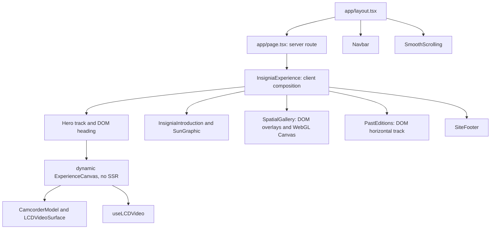
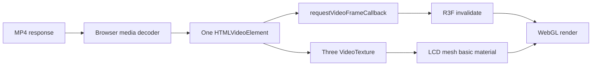
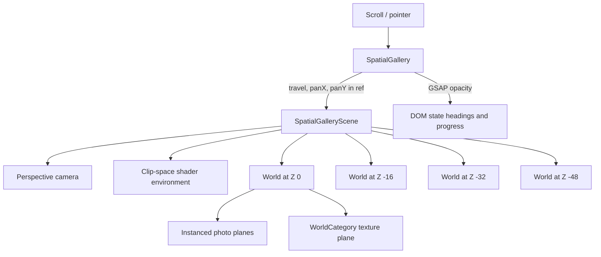

# Insignia: engineering architecture and learning guide

> **Basis and limits.** This document describes the checked-out source on 16 October 2026, at Git commit `0287948`, including uncommitted working-tree changes then present. The source files are the authority. Older reports in `docs/` describe earlier assets and animations and are not evidence for the current implementation. Asset headers and `ffprobe` were inspected; no browser frame-rate, cross-browser, or visual fidelity measurements were run for this document. “Observed” means confirmed in source or asset bytes; “risk” means a reasoned possibility that needs a runtime test. The document changes no application code.

## Contents

1. [Overall system architecture](#1-overall-system-architecture)
2. [Shared components and navigation](#2-shared-components-and-navigation)
3. [The 3D camcorder](#3-the-3d-camcorder)
4. [Video texture and fullscreen presentation](#4-video-texture-and-fullscreen-presentation)
5. [Video heading and section boundary](#5-video-heading-and-section-boundary)
6. [The sun and sticky introduction](#6-the-sun-and-sticky-introduction)
7. [Spatial gallery](#7-spatial-gallery)
8. [Past Editions and the separate marquee utility](#8-past-editions-and-the-separate-marquee-utility)
9. [Responsive architecture](#9-responsive-architecture)
10. [Performance engineering](#10-performance-engineering)
11. [Architectural alternatives](#11-architectural-alternatives)
12. [Architecture decision records](#12-architecture-decision-records)
13. [Mathematics and graphics concepts](#13-mathematics-and-graphics-concepts)
14. [Code walkthroughs](#14-code-walkthroughs)
15. [Independent engineering review](#15-independent-engineering-review)
16. [Learning roadmap](#16-learning-roadmap)
17. [Glossary and verification guide](#17-glossary-and-verification-guide)

## 1. Overall system architecture

### 1.1 What a visitor experiences

The visitor sees a fixed navigation, a camcorder containing moving film, a scroll-directed approach into its LCD, a heading over the resulting film, an introduction with a sun motif and three pieces of copy, a four-state photographic world navigated by scrolling and dragging, a horizontal Past Editions journey, and a footer. These are separate implementation systems presented as one continuous page. Their scroll positions and stacking order connect them; there is no global “experience state” object that drives every section.

### 1.2 Actual component tree and boundaries

`src/app/page.tsx` is a small server component returning `InsigniaExperience`. `src/app/layout.tsx` supplies the document, global CSS, `SmoothScrolling`, and the fixed `Navbar`. `InsigniaExperience.tsx` is a client component because it owns DOM refs and passes them to the hero. It mounts the other section components in document order. Only `ExperienceCanvas` is explicitly dynamically imported with `ssr: false`; this separates the browser-dependent hero renderer from server rendering. The gallery itself is a client component and conditionally mounts its Canvas after a media-query effect.



The DOM owns navigation, headings, buttons, accessible copy, indicators, and the Past Editions track. WebGL owns the camcorder mesh, LCD film surface, gallery image planes, watermark plane, and gallery environment shader. The hero and gallery use **different canvases**. The introduction is CSS and DOM, including its gradient sun. A full-screen film effect is achieved inside the hero WebGL canvas, not by switching to an HTML video overlay.

### 1.3 Ownership of time and state

The page has three timing mechanisms:

| Owner | What it advances | Where |
| --- | --- | --- |
| Document scroll measured by GSAP ScrollTrigger | Hero model/camera, introduction state, gallery camera depth, Past Editions track | `camcorderTimeline.ts`, `InsigniaIntroduction.tsx`, `SpatialGallery.tsx`, `PastEditions.tsx` |
| Browser/video clock | Decoded film frames; sun entrance after section entry; UI hover | `useLCDVideo.ts`, `LCDVideoSurface.tsx`, `InsigniaIntroduction.tsx`, layout components |
| Pointer events plus damped render frames | Gallery X/Y exploration; standalone marquee utility | `SpatialGallery.tsx`, `SpatialGalleryScene.tsx`, `InfiniteDraggableMarquee.tsx` |

`SmoothScrolling.tsx` constructs one Lenis instance when reduced motion is not requested. It sends Lenis `scroll` events to `ScrollTrigger.update()` and calls `lenis.raf(performance.now())` on the GSAP ticker. This means the scroll observer and smooth scroller are updated by a common scheduler, although browser scroll restoration and layout timing still require separate care. A body-style `MutationObserver` stops Lenis while the menu locks body scrolling. The component removes the ticker callback, observers, listeners, and Lenis instance during cleanup.

The sections do **not** share one GSAP master timeline. Each section owns a timeline and pin. Priorities 40 (hero), 30 (introduction), 20 (gallery), and 10 (Past Editions) request upstream measurements first during refresh. That ordering matters: a downstream start depends on the pin lengths above it. It does not make timing of all async mounts deterministic by itself.

### 1.4 Lifecycle from page load

The server can emit page structure and CSS. During hydration, the hero dynamic import begins loading, the gallery determines reduced-motion status and mounts WebGL when appropriate, and each client section registers effects. `useGLTF.preload()` requests the camcorder asset. The hero and introduction reserve scroll-track heights in CSS. The gallery reserves a track height before enhancement; its pin uses `pinSpacing: false`. Past Editions calculates its horizontal distance from its rendered track width. On unmount, each section reverts its own GSAP context or media query, while the video and WebGL components dispose resources they own.

**Teaching principle:** one component should own a timeline and its cleanup. React renders the stable structure; GSAP and Three mutate refs for per-frame motion. Putting camera coordinates in React state would cause component renders for frames that only need a matrix update.

### 1.5 Data and assets

`src/config/scene.ts` holds hero camera, rotation, lighting, and timeline settings. `src/config/introduction.ts` holds three introduction texts and their progress windows. `src/content/spatial-gallery.ts` holds four states, photo rectangles, depth offsets, and mobile placements. `src/content/past-editions.ts` holds years and image identifiers. These are hand-authored configurations rather than fetched CMS data. Browser assets live under `public/`; the main model is `public/models/camcorder-realism-v2.glb`, film under `public/videos/`, photos under `public/assets/insignia/`, and fonts under `public/fonts/`. Paths in config resolve directly to these public URLs. The local inspection tool `scripts/inspect-model.mjs` exists, but its default path points to an older model; give it the current GLB path if using it.

**Exercise:** draw a second diagram showing which objects are recreated if the gallery is removed and remounted. Mark textures, instanced meshes, ScrollTrigger, camera refs, and the independent hero video.

## 2. Shared components and navigation

### 2.1 Navbar and menu

**Experience.** The logo remains fixed near the upper left, the desktop links at the right animate glyphs on hover, and a yellow menu button opens a full-height panel. The logo hides on downward page scroll and reappears when scrolling upward.

**Implementation and execution.** `Navbar.tsx` maintains `open` in React state, plus refs for the header, logo, menu layer, button, panel, backdrop, GSAP timeline, and body-scroll unlock callback. A `useLayoutEffect` builds the menu timeline once: backdrop fades, panel translates, logo and links enter, and footer link appears. Reversing it closes the panel. The open-state effect changes visibility, locks `document.body.style.overflow`, sets the page `<main>` inert, moves focus, handles Escape and Tab, and restores the previous state in cleanup. Another effect listens to native scroll and tweens the logo's `yPercent`; it uses a movement tolerance and threshold from `src/config/navigation.ts`.

`NavLabel.tsx` draws links as SVG paths with duplicated glyphs in a clip rectangle. CSS translates each glyph upward on hover. The menu text and footer links use a similar duplicated-character span technique. `MenuIcon.tsx` loads a supplied Lottie animation dynamically, scrubs its frames through GSAP, and keeps a static SVG icon as a loading/failure fallback. `LumikaiLogo.tsx` uses the original inline SVG paths; on pointer enter or focus, its three dots drop and fade together, then return with staggered timings. The nav and footer reuse that component. The logo effect runs through a timeline attached to its nearest link, not through menu React state.

**Why it works.** Persistent refs let GSAP update DOM transforms without rerendering the menu for each frame. `inert` and focus trapping reduce interaction with obscured content. The backdrop and panel use separate layers, so opacity and translation can be timed independently.

| Choice | Benefit | Cost | Alternative |
| --- | --- | --- | --- |
| GSAP menu timeline | Explicit overlapping phases and reverse close | Imperative state must be cleaned up | CSS transitions with class toggles suit simpler menus |
| SVG duplicate glyphs | Shape-accurate logo/navigation animation | More markup and accessibility handling | Normal text spans are simpler if exact glyph artwork is unnecessary |
| Lottie menu icon | Reuses supplied animation | Runtime library and asset request | CSS/SVG path morph for a tiny fixed icon |

**Failure modes and assessment.** `document.body.style.overflow` is a shared mutable global: another overlay that writes it concurrently can conflict. The menu restores the previous value, which limits but does not eliminate the risk. The Lottie asset can fail; the static icon remains. The focus trap is hand-coded; an established dialog primitive would offer more tested edge-case behavior, especially with nested portals or changing focusable descendants. This is a potential accessibility risk, not a confirmed failure.

**Exercise:** open the menu, tab forward and backward, then disable the Lottie request. Explain which fallback is visible and which element receives focus on close.

### 2.2 Scroll indicator and shared CSS

`ScrollIndicator.tsx` is a reused presentational DOM component. Its yellow vertical line runs a CSS keyframe, and its supplied SVG draws “SCROLL.” It accepts a forwarded ref so the hero timeline can fade the same DOM element near fullscreen. The gallery mounts another instance with section-specific positioning. Because it is `aria-hidden`, it conveys atmosphere rather than essential instructions. `src/components/layout/ui.css` defines shared layer variables and most experience CSS; `src/app/globals.css` contains root/hero fundamentals; section CSS covers gallery and footer.

Reduced-motion CSS stops the scroll-indicator cycle and removes glyph transitions. The hero, introduction, gallery, and Past Editions also have logic or CSS fallbacks. Their precise fallback behavior differs; do not assume one global reduced-motion mode handles everything.

## 3. The 3D camcorder

### 3.1 The asset currently shipped

The checked-in GLB is a binary glTF 2.0 file of **13,069,372 bytes**. Its JSON chunk reports one scene, two nodes, one mesh with one triangle primitive, one PBR material, two textures, two embedded PNG images, zero animation clips, and zero skins. Its index accessor contains **66,862 triangles**. Both embedded images are 2048×1024. The material is a double-sided satin-black polymer with a base-color texture, roughness 0.31, metallic factor 0.08, and a normal map scale of 0.22. These are file facts; they do not establish how fast any particular GPU will render it.

Do not use the earlier `docs/model-inspection.md` figures as current metadata: that report concerns another GLB with a different size, hierarchy, and triangle count. The current source is selected by `sceneConfig.modelUrl` in `src/config/scene.ts`.

**GLB concept.** A GLB combines a glTF JSON scene description and binary buffers. Nodes form a transform hierarchy. A node may reference a mesh; a mesh contains primitives, each with vertex attributes, indices, and a material. Textures are sampled during fragment shading, and the GPU needs buffers and texture storage after the loader has decoded and uploaded them. A “scene” is a root collection, not necessarily a separate WebGL context. Here, the imported asset has no authored animation; rotation is supplied by code.

### 3.2 React Three Fiber bridge and transform hierarchy

`ExperienceCanvas.tsx` mounts `<Canvas frameloop="demand" dpr={[1,1.5]} camera={{fov:28}} ...>`, lights, and `CamcorderModel`. React Three Fiber (R3F) translates JSX such as `<group>` and `<mesh>` into Three.js objects. `useThree` provides camera, renderer, size, and `invalidate`. A ref to a group points to the live Three object. `invalidate()` asks R3F to draw when frameloop is `demand`.

`CamcorderModel.tsx` calls `useGLTF(modelUrl)`, clones the returned scene, refines its geometry normals and materials, computes a bounding box, and creates nested groups:

```text
animationGroup: rotates around Y while scrolling
└── orientation/scale group: fixed imported-model correction and radius normalization
    └── centering group: negative measured bounds center
        ├── cloned GLB scene
        └── calibrated LCDVideoSurface
```

Three composes transforms from child to parent. For a vertex `p_local`, its world position is `M_animation × M_orientationScale × M_center × M_imported × p_local` (homogeneous coordinates). Attaching the LCD under the same wrappers means the screen follows all model rotations and scales without a second synchronization system. The centering offset is the negative bounding-box center; the normalization factor is `targetRadius / measuredRadius`, with target radius 1. The fixed imported-model orientation is 200° about Y. Current outer animation begins at 18° and ends at 0°; these values are in `sceneConfig` and should not be copied from older prose.

`toCreasedNormals()` is applied to a cloned, temporarily enlarged geometry so curved surfaces are smoother without merging details across a small tolerance. The result is scaled back and disposed on unmount. Materials are cloned, roughness is floored at 0.42, normal intensity reduced, and texture anisotropy capped by hardware support and 8. This improves appearance but creates cloned GPU resources. `useGLTF.preload()` starts loading before the Canvas reaches the main render path. The cached source asset must not be disposed by the clone's cleanup; the code disposes cloned geometry/materials only.

### 3.3 Camera and LCD world targeting

`CameraRig.tsx` sets a perspective camera's vertical field of view, aspect, near/far planes, up vector, and initial pose whenever R3F size changes. The target lies near the model. The start distance is the maximum of three constraints: baseline camera distance, horizontal sphere fit, and vertical model fit. The horizontal half angle is `atan(tan(verticalFOV/2) × aspect)`. A narrow viewport therefore increases distance instead of clipping the model.

`LCDVideoSurface.tsx` constructs a calibrated geometry from `lcd-surface-v2.json`, positions it using `lcd-config.ts`, and exposes the root group via a ref. To compute the LCD in world space, `getLCDWorldFrame()` updates parent matrices, converts the local center with `localToWorld`, rotates local +Z by the screen's world quaternion to get the normal, and multiplies nominal LCD width/height by absolute world scale. The normal is normalized before the camera offset is calculated. This is essential: the LCD's local position alone ignores model rotation, normalization, and parent translation.

For distance `d` in front of a plane, the camera sees `2d tan(fovV/2)` vertically and `2d tan(fovH/2)` horizontally, where `tan(fovH/2)=aspect × tan(fovV/2)`. To **cover** the viewport with an LCD rectangle, both projected dimensions must be at least the viewport dimensions. Thus the code computes the two exact-fit distances and chooses the smaller:

```ts
const verticalDistance = frame.height / 2 / Math.tan(halfVertical);
const horizontalDistance = frame.width / 2 / Math.tan(halfHorizontal);
const distance = Math.min(verticalDistance, horizontalDistance)
  / sceneConfig.camera.fullscreenCoverage;
```

At that distance one dimension may exceed the viewport and be cropped. This is cover behavior. Choosing the larger distance would contain the whole LCD and potentially expose borders. Dividing by the configured `fullscreenCoverage` of 1.01 moves slightly closer. The endpoint position is `LCD center + normal × distance`; its orientation faces the LCD center. The code does **not** scale the LCD mesh to fullscreen and does **not** promote an HTML video element over the Canvas.

Numerical example: with vertical FOV 28° and 16:9 aspect, `tan(14°)≈0.249`, so the horizontal half-angle has tangent ≈0.443. For a world-space LCD 0.24 wide and 0.16 high, the vertical fit distance is `0.08/0.249≈0.321`; horizontal fit is `0.12/0.443≈0.271`. Cover chooses ≈0.271/1.01≈0.268 units. At that point the display height projects larger than the viewport and its top/bottom may crop. Those sample dimensions illustrate the formula; the runtime uses measured world values.

### 3.4 Actual camera animation

`createCamcorderTimeline()` is the sole hero ScrollTrigger owner. It pins the 100svh hero and travels for `section.clientHeight × 1.8` scroll pixels. A pre-sized `.hero-track` reserves `1 + 1.8` viewport heights while `pinSpacing:false` avoids double spacing. Timeline progress rotates the model in the first 20%, waits briefly, then changes `zoom.value` from 0 to 1 through the remainder. On every update, `renderCamera()` smooths normalized zoom, linearly interpolates camera position between start and end, interpolates the point of visual focus, calls `camera.lookAt(focus)`, updates projection, toggles the heading at threshold crossings, and calls `invalidate()`.

```mermaid
sequenceDiagram
  actor Visitor
  participant ST as ScrollTrigger
  participant TL as GSAP timeline
  participant R as renderCamera
  participant C as Three camera
  participant GPU as WebGL renderer
  Visitor->>ST: wheel/trackpad scroll
  ST->>TL: normalized pinned progress
  TL->>R: rotation and zoom values
  R->>C: position.lerpVectors; lookAt; projection update
  R->>GPU: R3F invalidate()
  GPU-->>Visitor: next canvas frame
```

Although `CameraPose` contains a quaternion, **the current travel does not perform quaternion interpolation or spherical linear interpolation (slerp)**. The start pose uses a quaternion and `camera.lookAt()` recalculates orientation during movement. This is worth teaching because an older design or report may describe quaternion interpolation. Quaternions are useful when directly interpolating two orientations: they avoid Euler axis-order surprises and allow shortest-path spherical interpolation. The present implementation instead aims at a moving target, reducing endpoint drift but depending on `lookAt()` each update. A focus point that passes through the camera or an inconsistent up vector could produce abrupt orientation changes; that is a general risk, not a demonstrated bug here.

On ScrollTrigger refresh, the code calculates targets again after temporarily placing the model at its final rotation. On resize, R3F size causes `CameraRig` and `CamcorderModel` effects to rerun. Cleanup cancels a scheduled refresh, reverts GSAP media/context, and disposes an optional debug path. Reverse scrolling drives the same values backward; no secondary reverse animation is created.

### 3.5 Performance, failure modes, and judgment

Demand rendering saves draw calls when nothing changes, but the playing video requests frames continuously, so the hero is not idle during playback. DPR is capped at 1.5: at a 3840×2160 CSS viewport this can still imply a large drawing buffer, up to roughly 5760×3240 pixels (about 18.7 million color samples before depth and multisampling). The model's embedded 2048×1024 RGBA images require about 8 MiB each uncompressed at base level; actual format, mipmaps, and driver allocation can change that number. The source code clones geometry and materials, so loading time and memory should be measured on representative devices. `SceneErrorBoundary` handles React rendering errors; the Canvas has a WebGL fallback, but neither guarantees recovery from context loss after initial mount.

**When another architecture wins.** If only a fixed animation and no 3D interaction were needed, a pre-rendered video or image sequence would reduce GPU code and cross-browser uncertainty, while sacrificing live projection and responsive geometry. If the camcorder required interactive orbit controls, the current real-time scene becomes much more valuable. See [Chapter 11](#11-architectural-alternatives).

**Exercise:** make an isolated Three.js page with a rectangle in an arbitrary rotated parent group. Compute its world normal, place a camera along that normal, then switch from cover to contain by replacing `min` with `max`. Do not alter the production hero.

## 4. Video texture and fullscreen presentation

### 4.1 What the visitor sees versus what runs

The film appears inside the open LCD and remains visible when the camera zooms in. It looks like a transition between media surfaces, but there is one `HTMLVideoElement`, one `VideoTexture`, and one LCD mesh throughout a live mount. `ExperienceCanvas.tsx` calls `useLCDVideo(heroRef)` above the Canvas and passes the owned resource into `CamcorderModel`, then `LCDVideoSurface`. The GSAP hero timeline changes geometry/camera transforms; it neither changes `video.src`, seeks, nor creates another player.

The current MP4 was inspected independently: **35,822,362 bytes**, H.264 video at **1280×720**, **25 frames per second**, AAC audio, and a **340.202-second** duration. Its top-level `moov` atom starts near the front of the file, before `mdat`, supporting fast startup. Browser decode speed and startup time were not measured.

### 4.2 Resource lifecycle and autoplay

`useLCDVideo.ts` runs an effect that creates a video element, sets `muted`, `defaultMuted`, `loop`, `playsInline`, and `preload`, creates a Three `VideoTexture`, loads a poster, configures both maps as sRGB/linear/clamp/no-mipmaps, then assigns the video URL. An `IntersectionObserver` checks whether the hero intersects the viewport. `visibilitychange` pauses playback when the document is hidden. `video.play()` may reject because of autoplay policy or other media errors; the hook classifies blocked/error state and `ExperienceCanvas` shows a Play/Retry button. The volume button unmutes inside its click handler and calls `play()` in that gesture, preserving the browser's audio authorization opportunity.

The poster is used until `loadeddata` or `playing` establishes a decoded frame. This avoids sampling an uninitialized video texture. Each playing/loaded/error/pause event can change React state, but no React state update happens for every decoded frame. Cleanup disconnects the observer, removes listeners, pauses video, removes the source, calls `load()` to release media pipeline state, and disposes poster and VideoTexture.

### 4.3 From decoded frame to pixels

The browser decodes compressed H.264 into video frames. Three's `VideoTexture` marks new frames available to its renderer; the renderer uploads/currently binds video content as a GPU texture. The calibrated LCD geometry contains positions and UV coordinates. The material samples the texture at interpolated UVs when rasterizing pixels. `LCDVideoSurface` attaches the texture to `meshBasicMaterial`, which avoids lighting changes on the film and disables tone mapping. A slight normal offset and polygon offset reduce z-fighting against the camcorder scan. The surface explicitly disables frustum culling because its custom geometry/bounds might otherwise be culled incorrectly during the zoom.

The surface aspect may differ from the 16:9 film. It computes a centered **cover crop in UV space** using the surface-to-video aspect ratio: one UV axis's repeat falls below 1 while the other stays 1, and the result is centered around UV 0.5. A texture repeat of 0.75 samples the central 75% of an axis. It removes edge content rather than stretching every film pixel to fit.

`requestVideoFrameCallback` supplies decode-aligned invalidations where available. A `requestAnimationFrame` loop while playing is the fallback. Both are canceled in effect cleanup. The result is an important split: **VideoTexture receives a new image; R3F still needs `invalidate()` to draw it because the Canvas uses demand rendering.** Missing this call would make a valid playing video appear frozen until another event repainted the scene.



### 4.4 Why continuity works, and where it could fail

The video resource is owned by `ExperienceCanvas`, which remains mounted while the hero's ScrollTrigger advances. The LCD mesh remains in the camcorder hierarchy, so the camera approaches it. No time synchronization scheme is required. A true unmount/remount of `ExperienceCanvas` would recreate the video and start it again; a resize or timeline refresh alone does not recreate the video hook. Potential black frames can arise before `loadeddata`, after a context loss, on a decode stall, or if the poster fails. Poster readiness and the `hasFrame` gate cover the initial period, not every runtime media failure. Large video uploads, antialiasing, and material sampling add GPU work. The current 720p file is smaller than the older 1080p file recorded in historical docs, but measured bandwidth/performance are still unknown.

| Method | Here? | Continuity | Trade-off |
| --- | --- | --- | --- |
| Same WebGL LCD mesh and VideoTexture, camera moves | Yes | Native, because player and texture stay mounted | Requires precise projection and GPU rendering |
| Overlay same HTML video element on top of canvas | No | Possible if one DOM player is repositioned | Harder to align over 3D during transition; simpler fullscreen decode path |
| New fullscreen video element synchronized by `currentTime` | No | Approximate and can drift or flash | Simple visual layer, duplicate decoding and autoplay complexity |

**Exercise:** in an isolated demo, use `frameloop="demand"` with a video material. Remove only the frame-callback invalidation and observe what causes redraws. Restore it, then compare frame cadence using a profiler.

## 5. Video heading and section boundary

`FullscreenHeading.tsx` is DOM over the hero canvas. It holds `visible` and the active GSAP tween in refs. The hero's `renderCamera()` calls `heading.reveal()` after zoom crosses the configured threshold 0.985 and `hide()` after it recedes below 0.95. The gap between thresholds is **hysteresis**: tiny scroll changes near one threshold do not constantly toggle the heading. On show, it fades and moves to y=0 over 1.2 seconds; on hide, it fades over 0.35 seconds, or immediately for reduced motion. The reveal is **time-based once triggered by scroll progress**. Scrubbing backward does not reverse individual tween frames in lockstep with scroll; it triggers a separate hide.

The CSS layering is explicit: hero background below Canvas, indicator above Canvas, heading above indicator, navbar above all. `.fullscreen-heading::before` paints a transparent-to-black gradient behind the text. The following introduction begins with a black background and an independent sun gradient in `.sun-core`. There is no shared continuous gradient object spanning the hero and introduction sections. The visual seam depends on the hero's last rendered frame, heading backdrop, and black section boundary. This is a source observation; whether the seam is objectionable requires an actual rendered comparison.

The DOM heading retains readable, selectable text and easier responsive typography than text rendered into a WebGL texture. Its time-driven reveal makes the entrance legible even if the user crosses the trigger quickly, but fast reverse scrolling can interrupt it; the component kills its prior tween and overwrites the same properties. The video is unaffected by this heading state.

**Exercise:** diagram the four cases around the thresholds: progress rising through 0.985, falling to 0.97, falling through 0.95, then rising to 0.97. Explain why only the first and third cases trigger a tween.

## 6. The sun and sticky introduction

### 6.1 Structure, animation, and data

The section shows a small number, divider, stylized sun, and copy. `introductionSlides` in `src/config/introduction.ts` contains three numbered text records. `InsigniaIntroduction.tsx` renders three DOM slide structures into one grid composition; CSS places all numbers in the same grid cell and all paragraphs in another. React does not swap a single stateful slide. GSAP sets the first visible and later nodes hidden, then timelines transition visibility and y-offsets. An `sr-only` ordered list presents the content independently of the decorative animation. Reduced-motion CSS hides the animated composition and shows a normal ordered list.

The section wraps a 100dvh pinned stage in a 320dvh track. ScrollTrigger's end is `section.clientHeight × 2.2` beyond start. Since `pinSpacing:false`, the CSS track contributes the required document travel length. The introduction's master timeline has two transition windows, 0.20–0.35 and 0.55–0.70. Each fades the old number/copy out, brings the new pair in, reveals another ray group, and changes sun core opacity/scale. The final remaining timeline span is a hold.

`SunGraphic.tsx` renders twelve DOM ray spans with configured angles and stage markers, plus the center core. CSS rotates each ray and gives the core a four-stop yellow/red/black gradient with a blur filter. This is **CSS compositing**, not a shader or a second WebGL scene. A separate paused `entrance` timeline animates the first slide, divider, sun, rays, and copy. `onEnter` or `onEnterBack` plays it once per component mount. Thus narrative changes are scroll-scrubbed, while the first entrance is time-driven after crossing the section boundary.

### 6.2 Why separate entrance and narrative timelines?

This lets the initial reveal finish at a human-readable pace even if scroll changes slightly. The cost is two clocks: on a deep restored scroll position, the entrance can start after the master timeline has already set a later narrative state, and overlapping property writes may cause a visual transient. That is a **potential synchronization risk inferred from the code**, not a confirmed bug. It merits a direct reload-at-section test. If deterministic scroll reconstruction were the highest priority, a single progress-driven timeline for both entrance and states would be easier to reason about, though it would change how the opening animation responds to fast scrolling.

`gsap.context()` scopes selectors to the section. `gsap.matchMedia()` creates the reduced-motion branch. Cleanup reverts both and kills the entrance timeline, so pin styles and tweens should not outlive a normal unmount. The CSS has a height-aware desktop rule for short viewports and a separate mobile grid. Its max-width and clamps constrain typography and spacing, but the mobile `.introduction` `min-height:620px` can exceed a short device viewport by design.

**Exercise:** write down the states of `numbers[0..2]` at master progress 0.1, 0.3, 0.5, 0.63, and 0.8, then test how an `onEnterBack` occurs when scrolling backward into the section.

## 7. Spatial gallery

### 7.1 User experience, scene structure, and ownership

The gallery opens on Leaders with a luminous red/orange environment, perspective-like grid, widely spaced category letters, photographs at different sizes, a top heading, right progress indicator, center scroll indicator, and drag instruction. Scroll advances through Founders, Experts, and Investors. Pointer dragging explores the current state's photographs in X/Y without advancing to another state. The two inputs are intentionally independent.

`SpatialGallery.tsx` owns the pinned ScrollTrigger, DOM headings/progress/indicators, pointer events, active travel value, and stored per-state pan offsets. `SpatialGalleryScene.tsx` owns the R3F camera's per-frame pose, texture acquisition, and mounts the WebGL environment plus each ready world. Each state is a `<group>` at a distinct depth conceptually, although the group itself has no position transform; child planes use the state's `depth` directly. The four depths are 0, −16, −32, and −48. There is one Canvas, one moving camera, and multiple world groups, not four separately mounted scenes.

The `GalleryEnvironment` is a full-screen shader plane that writes clip coordinates directly in the vertex shader. It does not sit at a finite world Z. Each `WorldCategory` is a textured plane behind the photographs at `world.depth − 1.5`; each `InfiniteCanvasPlane` contains instanced photographic planes at `world.depth + photo.depthOffset`. The DOM overlays are a sibling of the Canvas and do not inherit its camera transforms. A `GalleryBoundary` can switch to the static photo fallback if an error reaches React's error boundary. A failure reported by async texture loading also sets `failed` and causes that fallback.



### 7.2 Texture loading and state readiness

The scene makes a unique source list from all state photos. It first loads Leaders sources with `TextureLoader.loadAsync()`, marks them sRGB, then publishes a `Record<URL, Texture>` into React state and invalidates. After a 300 ms timeout it loads sources for later states. A world renders only when **all** of its source textures are present. The effect holds an `owned` array and disposes every loaded texture when unmounted; a late promise callback disposes a texture if cancellation has already occurred. The code does not use Suspense for these gallery textures. A deferred load error logs to the console but does not invoke the gallery fallback; a partial later state may therefore remain absent. That is a **confirmed error-handling gap in code**, although an actual failing request was not reproduced.

The texture pool is URL-based and unique at load time, but each photo's material is separately allocated in `InfiniteCanvasPlane`. The same image URL can appear in multiple states and the shared `Texture` object is configured with `repeat` and `offset` inside each world's resource creation. Since UV repeat/offset are **texture properties**, using one texture instance with different crops in different materials can couple crops across worlds if those materials expect different values. The data's aspect ratios and crops need inspection to determine whether this causes a visible defect; it is a credible architectural risk, not a proven mismatch. A per-photo UV transform in shader/material or cloned texture settings could isolate it if needed.

### 7.3 Mapping reference rectangles into world units

`mapPhoto()` in `layout.ts` reads a photo's explicit `[x,y,width,height]` rectangle measured against a **1440×900** reference. It uses the camera distance adjusted by that photo's depth offset. At that distance, a perspective camera with 40° vertical FOV sees:

\[
H_{visible}=2d\tan(40^\circ/2), \qquad
W_{visible}=H_{visible}(W_{viewport}/H_{viewport}).
\]

The code maps reference width to `w/1440 × W_visible`; for an explicit `referenceCrop` on desktop it maps height to `h/900 × H_visible`. It then centers the plane at `(x+w/2)/1440 × W_visible − W_visible/2` and vertically at `(.5−y/900)×H_visible − planeHeight/2`. The formula includes plane height because reference Y is top-down while Three Y is upward. If there is no desktop crop, height derives from actual image aspect ratio, preserving source proportions. UV repeat crops the texture centrally where plane and image aspect differ.

For example, a 160px-wide source rectangle at the reference's horizontal center maps to `160/1440≈11.1%` of the visible world width. At distance 8 and FOV 40°, visible world height is about `2×8×tan20°≈5.82`. On a 16:9 viewport its width is about 10.35, so the plane width is about 1.15 world units. At depth offset +0.3, the mapping uses distance 7.7 and produces a slightly smaller world plane so its **projected** width still matches the reference. A common error is to map every plane using the camera's base distance while placing some planes at offset Z; the nearby ones then project larger than their design rectangles.

On narrow mobile viewports, the function uses `mobileLayout` if present and otherwise cycles through `mobilePlacements`; it derives plane height from image aspect rather than reference crop. This is an intentional separate composition, not simple linear scaling of the desktop Figma rectangle. `InfiniteCanvasPlane` caps an internal aspect at 1.6 for parts of its tile resource calculations, while the camera itself still uses real viewport aspect. That combination deserves live ultrawide verification because tile coverage and authored first-frame projection are different concerns.

### 7.4 Scroll travel on Z and narrative transitions

`galleryConfig` sets base camera distance 8, depth step 16, four stop values `[0,.30,.55,.80]`, and exit values `[.15,.40,.65,1]`. The gallery pin end adds `section.clientHeight×4.5` of scroll after the stage arrives at viewport top. `SpatialGallery.tsx` creates one timeline, labels each state, tweens `motion.current.travel` from 0 to 3 between exits and subsequent stops, and cross-fades DOM headings and progress labels/marks. During each frame `SpatialGalleryScene.useFrame()` sets camera Z to `8 − travel×16`; at integer travel values it is directly in front of the corresponding state depth. One state is held at a time, then camera travel occurs in transition intervals.

Near-plane and group visibility matter. Every photo instance computes its `depth = cameraZ − (world.depth + photo.depthOffset)`. If that is at most 0.05 it sets instance count to zero. A state is visible only within a distance band, and material opacity uses `smoothstep` to fade near the far end. The `WorldCategory` uses a similar separation test. These checks stop adjacent worlds from remaining fully visible just because the physical camera frustum intersects them. They do not guarantee zero compositional leakage at every intermediate progress value; that needs visual review.

### 7.5 Dragging, damping, and repetition

Pointer down records the starting pointer, current integer state, whether touch is involved, and whether drag capture has begun. Dragging is refused while travel is more than 0.015 away from an integer state, so users do not pan while the camera is between narratives. Movement shorter than six pixels is ignored. A vertical touch movement wins browser-native page scrolling; a horizontal touch movement or mouse movement captures the pointer. Mouse dragging can change X and Y; touch dragging changes X only. The actual implementation therefore **does not provide vertical touch exploration**, even though mouse/trackpad pointer motion can be diagonal. The `.is-spatial` section uses `touch-action: pan-y` to preserve native vertical scrolling.

Pixel movement converts to world movement through the visible-height-per-pixel term `2d tan(fov/2)/section.clientHeight`. `panOffsets.current` stores X/Y for each state. `syncPan()` interpolates offsets of adjacent states while traveling, updates `motion.current`, and invalidates the Canvas. `SpatialGalleryScene.useFrame()` applies `MathUtils.damp()` to the camera's X/Y offset with coefficient 18 and clamped frame delta. Damping causes the visual camera to approach the target smoothly after a pointer event, without updating React state per frame. As long as motion remains above a 0.0001 threshold and the gallery is active, it requests another demand-rendered frame.

The canvas is “infinite” in the sense that there is no finite scroll edge in pointer space. It is **not** an infinite set of distinct photos. `InfiniteCanvasPlane` keeps a bounded `InstancedMesh` pool for each photo/material and repopulates matrices for cells near the current camera frustum. A deterministic `tileHash()` jitters cell centers, and arithmetic picks one existing photo index per cell. World positions use integer cell coordinates, so the arrangement is stable when revisited. The authored opening photographs remain at exact reference positions as instance 0. Extra instances are suppressed inside a protected opening zone and whenever they overlap an original photo's bounds. They are regenerated around the camera as it pans. There is no modulo wrapping of the camera position; the world coordinate can grow indefinitely. The theoretical limits are JavaScript/float precision, instance-pool capacity, repeated content, and per-frame cell iteration. The code does **not** implement drag velocity or inertia; its damping is camera catch-up to a target offset.

**A numerical damping intuition:** if the target jumps from 0 to 1, a damp coefficient 18 gives a per-frame approach factor near `1−e^(−18/60)≈0.26` at 60 Hz. First frame moves to ~0.26, next to ~0.45, and so on. The rendered camera lags, but pointer target does not itself decay. Large frame gaps are clamped at 0.05 s to avoid a huge jump after tab suspension.

### 7.6 Category watermark and the environment

`WorldCategory.tsx` draws widely spaced letters into a 2D canvas at twice the viewport pixel dimensions, creates a `CanvasTexture`, and maps it onto a plane at `world.depth−1.5`. In `useFrame`, the mesh copies camera X/Y; that cancels exploration panning **in screen projection**. Its Z remains attached to the narrative world so depth transitions change which word is visible. The photograph planes are in front; normal depth testing lets them cover letters. This achieves the desired visual centering without a DOM overlay. The drawback is large per-state canvas textures and repaint/recreation on viewport resize. For a 3840×2160 CSS viewport, a single 7680×4320 RGBA canvas is about 133 MiB before GPU copies; four states can be substantial. Browser texture-size limits also vary. This is a high-priority **potential** large-screen risk, not a measured failure.

`GalleryEnvironment.tsx` uses a full-screen shader plane with `gl_Position=vec4(position.xy,0.999,1.0)` so it is independent of perspective depth. Its uniforms are `radius`, `shift`, and `gridScale`. The fragment shader computes distance from a UV center, mixes orange at the center toward deep red and black, warps normalized UVs quadratically for a curved-grid impression, draws thin line/dot intersections with `fract`, `fwidth`, and `smoothstep`, and converts the constructed sRGB-like colors to linear before Three's output color-space include. `radius` blends between state presets as narrative travel advances. `shift` depends on camera X/Y, so the environment appears to respond gently to exploration. The shader does not use a sampled gradient image asset at runtime; it computes the colors procedurally.

**Failure modes and assessment.** The architecture separates Z narrative travel from X/Y exploration cleanly. The opening design rectangles are explicit, and instancing caps draw calls better than one mesh per repeat. The main costs are per-frame CPU matrix work, potential high-resolution watermark textures, and a subtle interaction between shared texture objects and per-photo crop configuration. The `sources` set loads every future asset after 300 ms even if users never reach those states; that improves later readiness but can compete with video decoding and transfer bandwidth. Nothing in source proves a target frame rate.

**Exercise:** build a small scene with one photograph at Z=0 and another at Z=−16. Fix FOV at 40°, move camera from Z=8 to −8, and compute each photo's projected size at several travel values. Then add a watermark plane that copies only camera X/Y and verify it stays centered while changing depth.

## 8. Past Editions and the separate marquee utility

### 8.1 The live Past Editions section

The visitor sees an editorial two-row sequence of photographs and year/title labels, but the whole strip moves horizontally as they scroll **vertically** through a pinned section. This is `PastEditions.tsx`. `pastEditions` data specifies year, title, which row contains the label, and image names. `editionCells()` converts each year's data into a column-major sequence of image/label cells. Four years are rendered as flex children; each year uses a two-row CSS grid with `grid-auto-flow: column`. `EditionMarqueeItem.tsx` uses Next `<Image fill sizes=...>` for photographs. The 2022 four-photo case appends a second instance of its first photo under a new ID so the lower trailing slot is occupied; this is **intentional duplication in data**, not an infinite-loop copy.

The stage is 100svh. `distance()` is `max(0, track.scrollWidth−viewport.clientWidth)`. A ScrollTrigger pins it from `top top` for that many pixels, and the timeline translates the track from X=0 to X=−distance while scaling a progress line from 0 to 1. A `ResizeObserver` watches track and viewport widths; if distance changes, it schedules `ScrollTrigger.refresh(true)` once on the next animation frame. Cleanup disconnects the observer, cancels the frame, and reverts `gsap.matchMedia()`.

The live section **does not** implement automatic motion independent of user scroll, drag-to-scroll, opposing row directions, tile wrapping, or seamless looping. Its accessible viewport can receive keyboard focus and has a reduced-motion CSS overflow-x fallback. Whether the focused region has useful keyboard scrolling in every browser needs testing. Calling this component an “infinite marquee” would misdescribe the source. The finite track reaches an end; that is consistent with a year-by-year editorial journey.

### 8.2 A separate reusable infinite marquee exists

`src/components/ui/InfiniteDraggableMarquee.tsx` is a client utility currently **not imported into PastEditions or elsewhere in `src`**. It accepts arbitrary React children, direction left/right, pixels-per-second speed, gap, draggable/pause-on-hover flags, and an accessible label. A sequence is repeated at least three times, or more according to viewport/sequence widths. `ResizeObserver` measures one sequence and preserves fractional phase when its width changes. `IntersectionObserver` disables motion outside the viewport. A RAF loop advances the offset by speed×delta plus decaying release velocity, wraps it to a negative interval of one sequence width, and mutates `translate3d` directly. Pointer movement waits seven pixels to decide whether intent is horizontal or vertical; vertical intent leaves native scroll alone, while horizontal captures the pointer and adds delta X. Release velocity decays exponentially. Reduced motion stops automatic movement and exposes horizontal overflow.

The wrapping function is:

```ts
const wrapOffset = (value: number, width: number) => {
  if (width <= 0) return 0;
  return ((value % width) + width) % width - width;
};
```

For width 300 and value −325, JavaScript remainder is −25; `((−25%300)+300)%300−300 = −25`. For value +10, the result is −290. Positions separated by an exact sequence width are visually equivalent **only if** repeated sequences have identical width and spacing. That is why the component duplicates the entire sequence and its trailing gap. A finite row translated to the left without copies would eventually show blank viewport; wrapping the transform alone would visibly jump unless the beginning and ending content were pixel-equivalent.

| Question | Live Past Editions | Standalone utility |
| --- | --- | --- |
| Motion source | Vertical scroll progress | RAF time plus pointer deltas |
| Looping | No | Repeated sequence plus modulo wrap |
| Dragging | No pointer handler | Horizontal drag with momentum |
| Opposing rows | No | Two instances could be configured opposite, but are not mounted here |
| Resize | ScrollTrigger refresh after measured width change | Recompute copy count and phase |
| Semantic structure | Grouped years and images | Arbitrary child nodes |

**Engineering judgment.** The live section is simpler and makes historical years navigable as a finite story. The utility is suitable when content must move continuously with input-independent speed. Combining them would require design and interaction decisions: scroll pin distance, drag momentum, accessibility, and finite year order could conflict. The existence of the utility alone is not proof that it was intended for the Past Editions section.

**Exercise:** use the utility in an isolated storybook-like page with two short text items. Compare `copies=1` and `copies≥3`, then simulate viewport width greater than a sequence width. Explain why the copy count formula must depend on viewport width.

## 9. Responsive architecture

### 9.1 What is responsive in source

CSS sizing uses `svh` and `dvh` for viewport-height-aware stages, `clamp()` for typography and image sizes, max-widths for some content, and media queries for short-height desktop and mobile compositions. The hero model starts at an aspect-aware distance. Both canvases receive size updates from R3F; `CameraRig` resets camera aspect/projection, and the hero endpoint is recomputed from the LCD frame. The gallery's reference-to-world mapping uses current viewport width/height and each photo's depth, while mobile receives explicit alternate placements. The Past Editions width and pin distance are measured from actual DOM dimensions, not assumed from a 1440px screenshot. On large CSS widths, site content such as the footer panel is constrained to 1920px, while full-bleed WebGL still fills the viewport.

**Width alone is insufficient.** At 1440×900, the visible gallery height for distance 8 and 40° FOV is the same world distance as at 1440×768 because the camera's vertical FOV and distance are fixed; what changes is aspect, visible width, and the mapping of reference rectangle proportions into world units. Text near top/bottom, navbar space, and image overlap depend on viewport height. `@media (min-width:1440px) and (max-height:820px)` addresses some short desktop cases. Browser zoom changes CSS viewport dimensions and often DPR; OS display scaling does likewise indirectly. The layout correctly reads CSS dimensions rather than detecting operating systems.

### 9.2 Limits and unverified cases

`mapPhoto()` uses 1440×900 as the source coordinate system, which is sensible for **mapping authored design data**, but it does not prove the resulting composition looks right at every aspect ratio. The hero's single calibrated LCD surface and static imported scan may crop differently on ultrawide screens, even if the mathematical cover equation is correct. The gallery environment shader uses UVs without aspect correction in its radial-distance expression; an ellipse on a wide viewport can be intentional, but its perceived glow shape varies by aspect. The category watermark scales its 2D canvas with full viewport width and height, which raises large-display memory concerns. The CSS footer limits its panel width; the background remains full-bleed. No physical Mac/Windows browser matrix was run in this documentation pass. Do not treat CSS equations as proof of visual fidelity.

For a useful verification matrix, include 1440×768/900, 1920×1080/1200, 2560×1080/1440, and 3440×1440 as **CSS** viewport sizes. Capture hero initial/final, introduction first/later state, all gallery states at rest and after drag, Past Editions start/end, and footer seam. Test native browser restoration on reload at each pinned section. Record device pixel ratio separately; a 3840 physical-pixel monitor can expose only 1920 CSS pixels at 2× scaling. Memory load depends on the actual canvas drawing-buffer dimensions.

**Exercise:** for FOV 40°, distance 8, calculate gallery visible width at 1440×900 and 2560×1080. Then explain why mapping a 160px reference photo to `160/1440×visibleWidth` makes it occupy the same horizontal fraction of both screens, while its physical pixel size differs.

## 10. Performance engineering

The browser's pipeline matters here. React runs on the main thread to build DOM and Three objects. ScrollTrigger and pointer handlers update JS refs or DOM transforms. CSS transforms can often be composited without relayout; filters and large gradients may trigger extra raster work. WebGL draws meshes into canvas buffers on the GPU; textures and decoded video frames occupy memory beyond compressed file bytes. `requestVideoFrameCallback` aligns redraw requests with video decode. The gallery's `useFrame` iterates its active worlds, materials, and grid cells; instancing reduces draw calls but does not make the CPU loop free.

At 60 Hz a complete JS/paint/GPU pipeline nominally has about 16.7 ms per frame, and at 120 Hz about 8.3 ms. These are frame-period arithmetic, **not measured performance**. GSAP scrub adds visual lag intentionally; it should not be confused with dropped frames. Lenis adds its own interpolation. The two smoothers can combine to make scroll feel delayed even when frame times are good. Conversely a long main-thread texture decode or synchronous resize can hitch despite responsive CSS.

Observed performance choices include dynamic import of the hero Canvas, model preload, demand rendering, capped DPR, video-frame-triggered invalidation, unique gallery source loading, instanced photo planes, phase-preserving marquee measurement, and intersection-based pause for the standalone marquee. Cleanup is explicit for video, textures, geometries, GSAP contexts, timers, listeners, and observers. Costs include two canvases, large GLB embedded textures, normal processing on a cloned mesh, video decode/upload, high-resolution watermark canvases, transparent instanced materials, a full-screen fragment shader, CSS blur and backdrop-filter, and per-frame instance matrix updates. Nothing in source alone establishes 60 FPS, acceptable memory, or absence of layout shifts.

**Measurement plan.** Use Chrome/Edge Performance traces and GPU memory tools where available, inspect WebGL renderer info for draw calls/triangles/textures, sample frame durations while scrolling gallery and zooming hero, and use the Network panel to confirm video range requests and texture concurrency. Compare 1×/2× DPR, 1440×900 versus ultrawide, and a lower-powered Windows GPU. Profile each section separately before changing DPR or replacing architecture. A long task in JS, large upload, or shader-bound GPU frame requires a different fix; one blanket “optimization” is unlikely to solve all three.

## 11. Architectural alternatives

This chapter compares the **implemented** solution against credible substitutes. “Reason it might have been selected” is an inference from requirements and code, not knowledge of the original author's intent. Difficulty, accessibility, and scalability vary with team expertise and the content contract. The assessments below favor a specific alternative only when the observed requirements support it. Performance claims are directional until benchmarked.

### 11.1 React Three Fiber versus vanilla Three.js

**Current:** R3F mounts two canvases, handles Three object construction from JSX, and provides `useThree`, `useFrame`, and disposal integration. **Alternative:** vanilla Three creates scenes, cameras, renderers, objects, and loops imperatively, with hand-written resize and teardown. A likely reason for R3F is co-location with React components, assets, and suspense boundaries. R3F improves maintainability for a React team and makes declarative scene trees inspectable; vanilla improves direct control and removes React reconciliation overhead. Neither changes GPU draw-call cost by itself. Vanilla becomes more complex to wire into Next/React lifecycles and often harder to debug if cleanup is scattered. R3F's abstraction can obscure when objects are recreated. Both need DOM alternatives for screen-reader content. **Assessment:** retain R3F for these interleaved UI/3D sections; consider vanilla for a self-contained graphics engine with an existing imperative team. Evidence: `ExperienceCanvas.tsx`, `SpatialGalleryScene.tsx`.

### 11.2 ScrollTrigger versus CSS ScrollTimeline / native scroll-driven animations

**Current:** GSAP pins stages, normalizes progress, sequences DOM/Three updates, and handles refresh. **Alternative:** CSS scroll timelines animate CSS properties directly; JavaScript can read native scroll progress for camera transforms where supported. ScrollTrigger may have been chosen because pinned 3D camera motion and explicit cross-component callbacks are central. Native CSS can reduce JavaScript for simple opacity/transform effects and may run efficiently on the compositor. It cannot directly set Three camera vectors without a bridge, and complex pin geometry differs from a simple scroll timeline. GSAP adds dependency size, pin refresh and cleanup concerns. CSS timelines can be simpler to maintain for isolated text effects, but browser support and debugging semantics must be verified against the target matrix. Accessibility depends on equivalent reduced-motion behavior rather than the library. **Assessment:** keep ScrollTrigger for the hero/gallery camera; consider native CSS for small independent decorative transitions. Evidence: four timeline owners named in Chapters 1 and 10.

### 11.3 WebGL image planes versus DOM/CSS 3D transforms

**Current:** gallery photos are instanced meshes projected by one Three camera, with depth fading and a shader environment. **Alternative:** absolutely positioned `` elements, CSS `transform: translate3d(...)`, and a DOM perspective container. The current approach likely serves depth travel and large repeated terrain with bounded draw calls. DOM images preserve native semantics, focus, context menus, and easier loading/inspection. But hundreds of repeated nodes increase style/layout and compositor work; coordinated projection becomes more custom CSS/JS. WebGL offers batching and consistent camera math but needs a static accessible fallback and explicit GPU resource control. Debugging DOM placements is easier; debugging a shader and instance matrices is harder. **Assessment:** WebGL is defensible for the repeated multi-depth world; if the number of unique images remains small and repetition is unnecessary, DOM transforms could reduce complexity and improve accessibility. Evidence: `InfiniteCanvasPlane.tsx`, `AccessibleGallery`.

### 11.4 Perspective camera motion versus scaling/translating objects

**Current:** hero camera physically approaches the LCD; gallery camera moves along Z. **Alternative:** hold camera fixed and scale/translate the camcorder, LCD, or world layers. Moving the camera preserves a consistent perspective relationship between objects and naturally changes apparent size with distance; object scaling can reproduce a narrow effect with simpler target framing but may distort relative depth and require synchronizing many layers. Camera movement can be more sensitive to near-plane clipping and orientation. Both are cheap relative to rendering; choice is about composition and debugging. DOM accessibility remains separate. **Assessment:** retain camera motion for the hero and gallery where depth is part of the intended experience; scaling is appropriate for a flat poster-like visual. Evidence: `camera-path.ts`, `SpatialGalleryScene.tsx`.

### 11.5 VideoTexture versus HTML video overlay

**Current:** the existing video player is sampled through a Three texture on calibrated LCD geometry. **Alternative:** position an HTML `<video>` over the projected LCD (possibly transform/perspective it), then expand it to fullscreen. The present method maintains exact occlusion by the model and one video surface during camera travel. An overlay is easier to inspect, may avoid WebGL video texture uploads, and retains native media controls/captions if provided. It is difficult to track an irregular LCD quad and preserve convincing depth/occlusion at every camera pose. VideoTexture adds GPU uploads and WebGL context dependence; accessibility still needs DOM controls. **Assessment:** keep VideoTexture for the calibrated embedded display; an overlay would be better for a simple flat rectangle or if captions/native video interaction become dominant. Evidence: `useLCDVideo.ts`, `LCDVideoSurface.tsx`.

### 11.6 One persistent canvas versus two isolated canvases

**Current:** hero and gallery each mount a separate R3F Canvas. **Alternative:** one canvas spans the entire page, with scene content and camera mode switched or moved at section boundaries. The current isolation allows independent camera FOVs, lifecycles, and failure boundaries; it may have been chosen for easier section ownership. A single canvas could share renderer resources and reduce simultaneous context overhead, but greatly complicates DOM alignment, z-index layering, scrolling between sections, and asset lifetimes. Separate canvases can consume more GPU memory and context slots, though one may be outside viewport. Debugging is easier when each section has one owner. Accessibility remains DOM in both. **Assessment:** retain isolation unless profiling shows context/memory pressure; then consider a shared renderer with an explicit scene router. Evidence: `ExperienceCanvas.tsx`, `SpatialGallery.tsx`.

### 11.7 Procedural shader gradient versus CSS gradient/image

**Current:** gallery glow and curved grid live in one fragment shader; hero/introduction/footer gradients are CSS or assets. **Alternative:** CSS radial/linear gradients and a static or SVG grid under transparent photo planes. Shader uniforms allow state radius and exploration shift to affect every pixel without DOM repaint, and keep the background in the same WebGL compositing pipeline. CSS is simpler to maintain, accessible to designers, and often adequate for a static gradient. The shader consumes a full-screen GPU pass and is harder to color-match or inspect. A CSS gradient cannot depth-composite behind WebGL photos in the same way without canvas transparency and extra stacking rules. **Assessment:** keep shader where moving grid/gradient is required; for static color only, CSS is objectively simpler. Evidence: `GalleryEnvironment.tsx`, `ui.css`.

### 11.8 Instanced recycling versus duplicated grids

**Current:** each photo type has a bounded `InstancedMesh`; CPU code chooses cells near the camera and writes matrices. **Alternative:** pre-render a very large repeated mesh/DOM grid or duplicate finite image rows/tiles. Instancing bounds draw calls and memory as exploration grows; a huge static grid is simpler to reason about but either ends visibly or grows memory with reachable distance. Recycling costs CPU work and complicates overlap rules. Each distinct image/material still uses at least one draw call; instancing does not merge different textures automatically. Debugging instance index/cell selection is harder than inspecting static nodes. **Assessment:** retain recycling if open-ended drag is a real requirement; for a known maximum drag extent, a finite authored grid may be easier to maintain. Evidence: `InfiniteCanvasPlane.tsx`.

### 11.9 GSAP timelines versus React state-driven orchestration

**Current:** timelines mutate camera refs and DOM styles; React state mostly handles menu open, texture readiness, video status, and gallery enhancement/failure. **Alternative:** store every animation progress value in React state and render transforms declaratively. GSAP avoids React reconciliation on each scroll/video frame and gives reversible timing. React state would make current values easier to inspect and test at a coarse semantic level, but high-frequency updates can cause expensive rerenders, especially with R3F. GSAP's imperative lifecycle is harder to reason about during remounts and refresh. A hybrid is often best: semantic state in React, continuous motion in mutable refs. **Assessment:** the current division is sensible, but cross-timeline refresh/entry behavior should be tested. Evidence: `camcorderTimeline.ts`, `InsigniaIntroduction.tsx`, `SpatialGallery.tsx`.

### 11.10 Demand rendering versus continuous rendering

**Current:** both canvases use `frameloop="demand"` and explicit invalidation on camera motion, video frames, texture readiness, and gallery damping. **Alternative:** render every animation frame unconditionally. Demand rendering saves idle GPU work when canvases are static. It raises correctness risk: forgetting one invalidation can freeze valid state, and video naturally invalidates at its frame cadence anyway. Continuous rendering is easier to debug and supports always-moving shaders, but wastes work when sections are offscreen unless paused. Accessibility unaffected directly; energy/battery use affects users. **Assessment:** retain demand mode with a checklist of every mutable input that must invalidate. Evidence: `ExperienceCanvas.tsx`, `LCDVideoSurface.tsx`, `SpatialGalleryScene.tsx`.

### 11.11 DOM overlay typography versus typography inside WebGL

**Current:** headings and indicators use DOM overlays; the category watermark uses a `CanvasTexture` on a WebGL plane. **Alternative:** place all typography in DOM, or render all typography in WebGL. DOM text has native font rendering, selection, responsive CSS, and easier accessibility. WebGL text sits at a deliberate depth and can be covered by photos without DOM masking; it requires texture management and accessibility duplication. The watermark currently copies camera X/Y to stay centered, a clever compromise with significant memory cost. A DOM watermark behind a transparent Canvas could achieve fixed positioning but would need careful canvas alpha, depth/stacking, and heading order. **Assessment:** DOM for information-bearing text remains clearly preferable; the WebGL watermark is justified mainly by photo occlusion and needs large-viewport profiling. Evidence: `WorldCategory.tsx`, `SpatialGallery.tsx`.

### 11.12 Camera-relative versus world-space backgrounds

**Current:** the environment draws in clip space, unaffected by camera Z, while its shift uniform responds modestly to camera X/Y. **Alternative:** put a giant gradient/grid plane at fixed world Z, or attach a plane directly to the camera in world coordinates. A fixed world plane naturally shows perspective as camera moves but can cross near/far planes and change scale unexpectedly through the four-state journey. A camera-attached plane stays visible but needs careful depth ordering. The clip-space shader is predictable and cheap in geometry, although it does not produce physically correct 3D parallax. It is difficult to debug with ordinary world-space helpers. Accessibility is irrelevant for decoration but important for any text embedded into the plane. **Assessment:** clip-space is appropriate for a stylized, always-present backdrop; a real room or curved surface would need world-space geometry. Evidence: `GalleryEnvironment.tsx`.

### 11.13 Decision matrix by concern

| Concern | Current architecture tends to favor | An alternative tends to favor | Key test before switching |
| --- | --- | --- | --- |
| GPU memory | Small bounded instance counts, but two contexts and large textures | One canvas/DOM images might lower duplicate buffers | Measure peak GPU memory and context loss |
| Main-thread cost | GSAP mutation and instancing loops | CSS compositor effects may lower JS for simple text | Performance trace of long tasks |
| Team maintenance | React/R3F component ownership | Simpler DOM/CSS for non-3D sections | Time a representative design change |
| Debugging | Explicit named timelines and refs | DOM inspectability, native media overlays | Reproduce a refresh/resize defect |
| Scalability | Recycled image world | CMS-driven semantic DOM when content grows | Count unique images, tiles, and changes per release |
| Accessibility | DOM heading/fallback layers | Fully DOM gallery/film controls | Keyboard and screen-reader audit |

None of these rows implies a universal winner. Selection depends on interaction goals, target devices, asset count, and team skill; this repository has no recorded benchmark comparing the alternatives.

## 12. Architecture decision records

These ADRs record **what is implemented and an independent assessment**. Constraints are inferred from the code and interaction, not claims about developer deliberation.

### ADR 1 — R3F for the camcorder and gallery

- **Decision:** Two R3F Canvases contain the hero and gallery WebGL scenes.
- **Context:** Model projection, video mapping, camera travel, and depth-layer image worlds.
- **Constraints (inferred):** Integration with React/Next, responsive size, explicit cleanup.
- **Alternatives:** Vanilla Three; pre-rendered media; DOM 3D for photos.
- **Trade-offs:** Declarative scene composition and hooks versus framework/runtime overhead and two WebGL contexts.
- **Consequences:** Maintain renderer lifecycle and memory separately per section; DOM fallbacks remain necessary.
- **Assessment:** Retain, pending performance measurements on large/low-end displays.
- **Confidence:** High on implementation, medium on motive/performance.
- **Evidence:** `ExperienceCanvas.tsx`, `SpatialGallery.tsx`, `SpatialGalleryScene.tsx`.

### ADR 2 — Section-owned GSAP ScrollTriggers

- **Decision:** Hero, introduction, gallery, and Past Editions each own a pinned timeline.
- **Context:** Four very different animations share one document scroll.
- **Constraints (inferred):** Reverse travel, independently tunable scroll distances, resizing.
- **Alternatives:** One global timeline; native CSS scroll timelines; manual scroll listeners.
- **Trade-offs:** Local ownership and clear cleanup versus cumulative pin measurement and refresh coordination.
- **Consequences:** Changing one section's height can move every downstream trigger; test scroll restoration and deep links.
- **Assessment:** Retain, but add integration tests for refresh and browser back/forward navigation.
- **Confidence:** High on implementation, medium on motive.
- **Evidence:** `camcorderTimeline.ts`, `InsigniaIntroduction.tsx`, `SpatialGallery.tsx`, `PastEditions.tsx`.

### ADR 3 — VideoTexture on calibrated LCD geometry

- **Decision:** Use one video element and its texture on a custom screen mesh.
- **Context:** Moving film must stay physically attached to the camcorder during camera travel.
- **Constraints (inferred):** Continuous playback, uneven scanned display surface, cover crop.
- **Alternatives:** HTML video overlay; flat plane; separate fullscreen player.
- **Trade-offs:** Convincing occlusion and continuity versus upload cost and WebGL-dependent playback.
- **Consequences:** Source film, texture, and geometry lifetimes must remain aligned; context loss requires attention.
- **Assessment:** Retain for this visual effect; use native video for captions/controls if added.
- **Confidence:** High.
- **Evidence:** `useLCDVideo.ts`, `LCDVideoSurface.tsx`, `lcd-surface-v2.json`.

### ADR 4 — Direct camera approach to fullscreen LCD

- **Decision:** Interpolate camera position toward a pose along the LCD normal and aim at an interpolated focus point.
- **Context:** Screen should fill viewport without apparent late correction.
- **Constraints (inferred):** Different aspect ratios, reversible scroll, intact model hierarchy.
- **Alternatives:** Camera waypoint path; model scaling; DOM video transition.
- **Trade-offs:** Physically coherent projection versus clipping sensitivity and pose calculation complexity.
- **Consequences:** Any model/LCD calibration change requires endpoint reevaluation across viewports.
- **Assessment:** Retain while inspecting short and ultrawide viewports; older documentation's quaternion claim must stay retired.
- **Confidence:** High on code, medium on visual outcome.
- **Evidence:** `camera-path.ts`, `camcorderTimeline.ts`.

### ADR 5 — Separate time-driven sun entrance

- **Decision:** Entrance timeline plays once on section entry; state transitions follow scroll progress.
- **Context:** Initial reveal should have a readable duration, while later story changes respond to scroll.
- **Constraints (inferred):** Three text states and staged rays, reduced-motion fallback.
- **Alternatives:** One fully scrubbed timeline; three discrete IntersectionObserver states.
- **Trade-offs:** Expressive entrance versus two clocks and possible restoration transients.
- **Consequences:** Deep reload and rapid reverse tests are important.
- **Assessment:** Retain if entrance behavior is a firm design requirement; otherwise unify clocks for determinism.
- **Confidence:** High on implementation, low on original intention.
- **Evidence:** `InsigniaIntroduction.tsx`, `introduction.ts`.

### ADR 6 — Recycled instanced gallery cells

- **Decision:** A fixed-size instance pool is repopulated around the camera for each source photo.
- **Context:** Users may drag well beyond the authored opening frame.
- **Constraints (inferred):** Bounded draw calls and no blank canvas after exploration.
- **Alternatives:** Large finite authored canvas; DOM tile virtualization; shader texture atlas.
- **Trade-offs:** Unbounded navigation with repeated content versus CPU cell selection and complex overlap rules.
- **Consequences:** Precision, pool bounds, and stable deterministic hashes require tests.
- **Assessment:** Retain for an open-ended canvas, but decide whether repetition is acceptable editorially.
- **Confidence:** High on mechanism, medium on design intent.
- **Evidence:** `InfiniteCanvasPlane.tsx`, `spatial-gallery.ts`.

### ADR 7 — WebGL category watermark

- **Decision:** Render category letters to a canvas texture on a world-depth plane that follows camera X/Y.
- **Context:** Letters should stay centered under photograph planes while panning.
- **Constraints (inferred):** Proper photo occlusion; narrative-depth visibility.
- **Alternatives:** Screen-space DOM watermark behind transparent Canvas; per-letter meshes; CSS masking.
- **Trade-offs:** Simple depth relationship versus very large textures and font/rendering differences.
- **Consequences:** Resize may regenerate large textures and needs memory profiling.
- **Assessment:** Reconsider for large desktop displays if profiling confirms memory pressure.
- **Confidence:** High on implementation, medium on cost until measured.
- **Evidence:** `WorldCategory.tsx`.

### ADR 8 — Scroll-driven finite Past Editions

- **Decision:** Pin a finite DOM image track and translate it across the measured overflow distance.
- **Context:** Sequential 2025–2022 editorial content.
- **Constraints (inferred):** Preserve year grouping and clear end boundary.
- **Alternatives:** Standalone infinite draggable marquee; horizontal native scroll; CSS scroll timeline.
- **Trade-offs:** Deterministic progress and simple navigation versus absence of auto-loop and drag controls.
- **Consequences:** Copy/descriptions suggesting infinity or opposing rows must be corrected, or implementation changed explicitly.
- **Assessment:** Retain if the goal is an edition journey; choose the separate utility only for genuinely continuous motion.
- **Confidence:** High on implementation, low on unrecorded product intent.
- **Evidence:** `PastEditions.tsx`, `content/past-editions.ts`, `InfiniteDraggableMarquee.tsx`.
